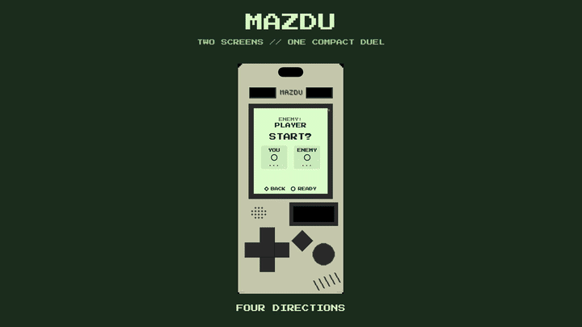
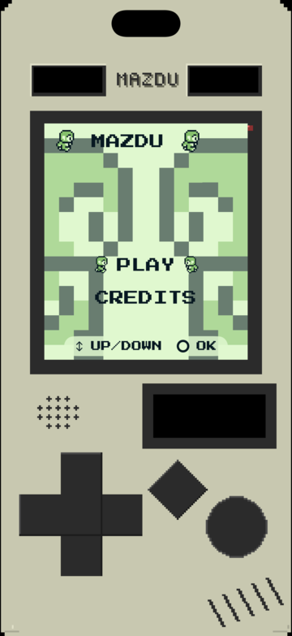
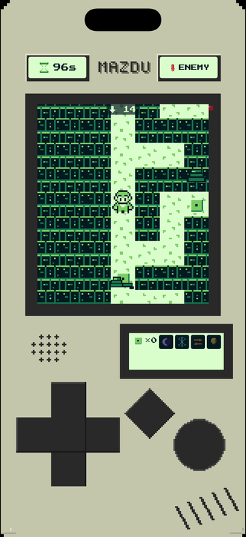
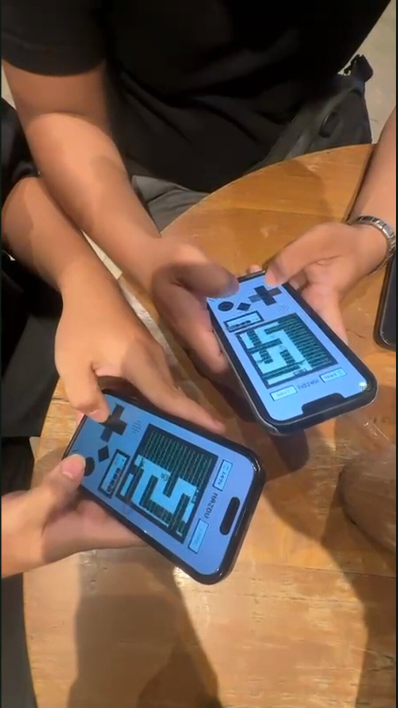

# MazDu

**A two-phone maze duel for iPhone.** Two players race down a scrolling maze on their own iPhones and slow each other down with random skills. The phones connect straight to each other with MultipeerConnectivity, so there's no server and no internet. Whoever gets furthest in 60 seconds wins.

<p align="center">
  
</p>

## Why I made it

MazDu was my entry for an Apple Developer Academy game jam with the theme **Compact**. Teams needed at least three people; I designed, coded, and tested it on my own in a few weeks, then ran the booth by myself at the showcase.

<p align="center">
  
  
  
</p>

## How it works

- **Peer-to-peer:** `MultipeerConnectivity` finds the other phone nearby and sends moves and attacks between the two devices.
- **Shared maze:** both phones build the same maze, so only small game messages travel between them.
- **Skills:** dice pick-ups in the maze roll a random skill: Freeze or Darken your opponent, Switch places with them, or raise a Shield.
- **Built for the room:** recovers when a player leaves or the connection drops, and supports quick rematches.

```
MazDu/
├── Models/       maze, skills, game rules, network messages
├── Services/     MultipeerManager (connection), GameFeedback (haptics, sound)
├── ViewModels/   match and race state
└── Views/        menu, maze, credits, and the handheld-style shell
```

## Run it

- Xcode with the iOS 18 SDK or later
- **Two physical iPhones** on iOS 18+. Peer discovery needs real devices; the Simulator can't find a second phone.

Open `MazDu.xcodeproj`, set your own signing team, and run on both phones.

## Credits

- Music: "Itty Bitty 8 Bit" by Kevin MacLeod (incompetech.com), licensed under [CC BY 4.0](https://creativecommons.org/licenses/by/4.0/). Converted from MP3 to WAV; no other changes.
- Music: "Game BOI 2" by HoliznaCC0, released under CC0 1.0.

Credits are also shown inside the game.

---

Made by [Rahmandhika Putra Purwadi Wicaksono](https://www.linkedin.com/in/rahmandhika). Portfolio: [rahmandhika.com](https://rahmandhika.com)
